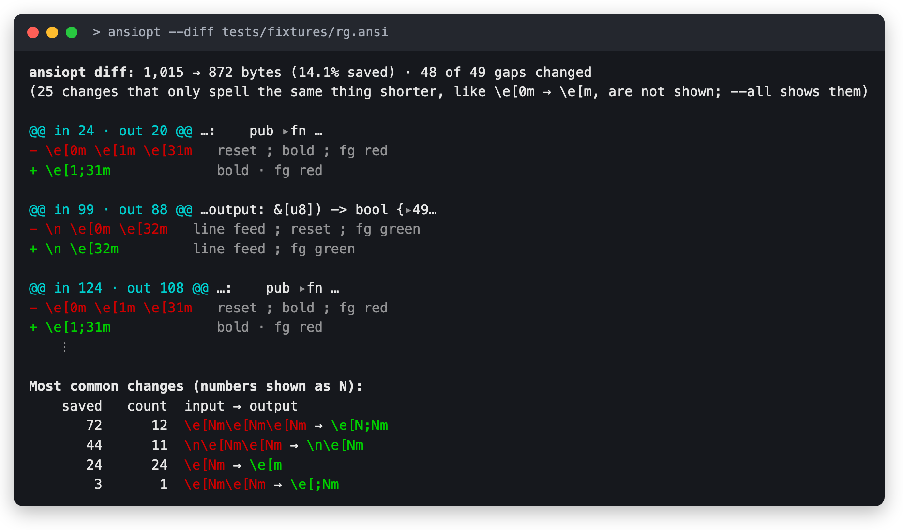
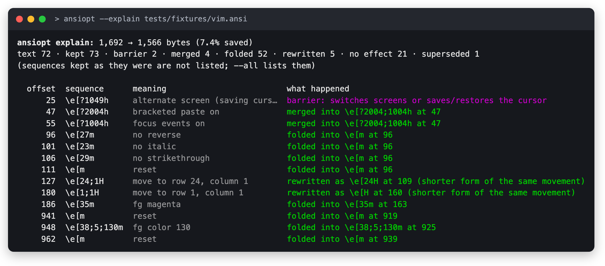
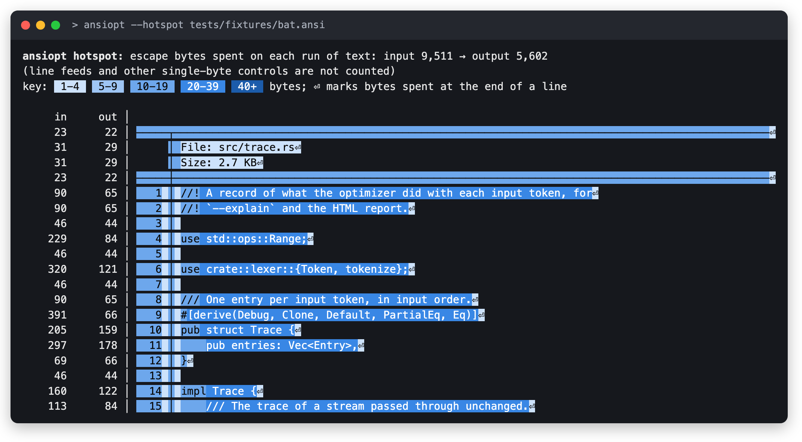
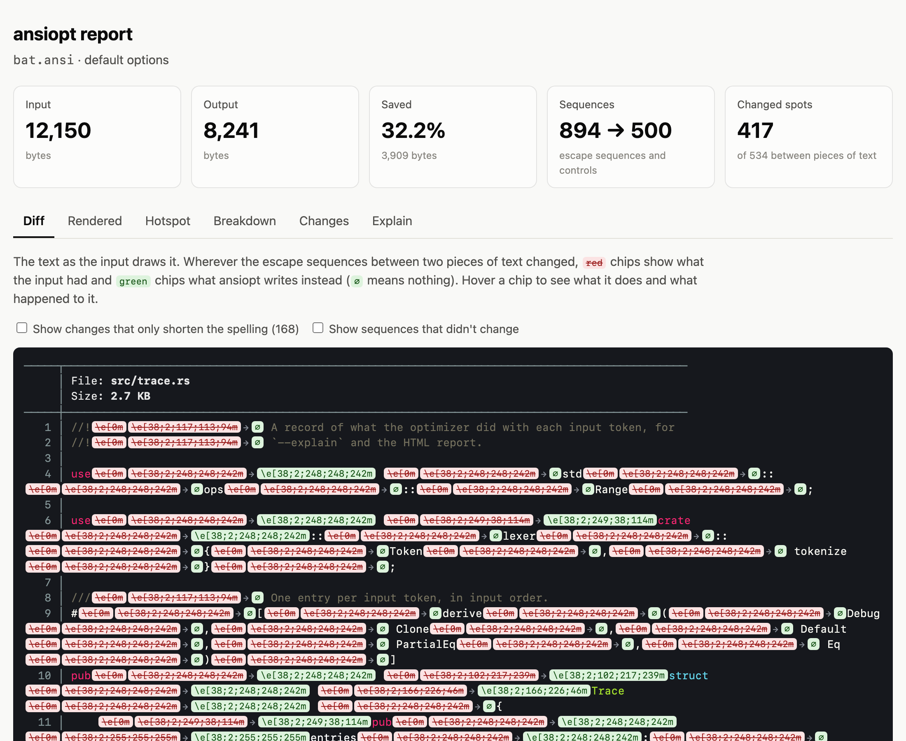
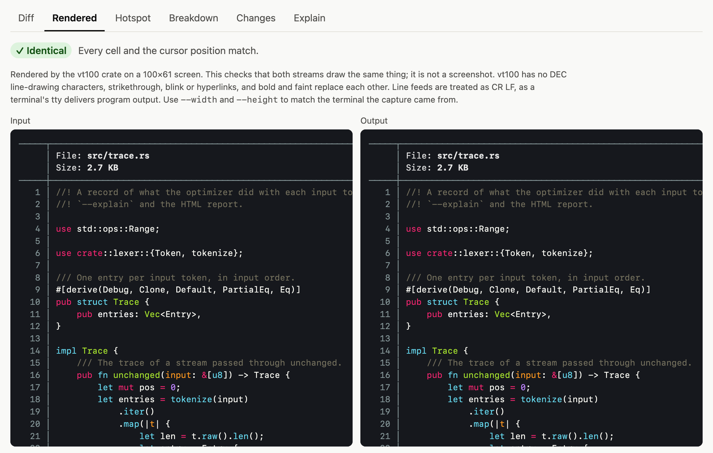
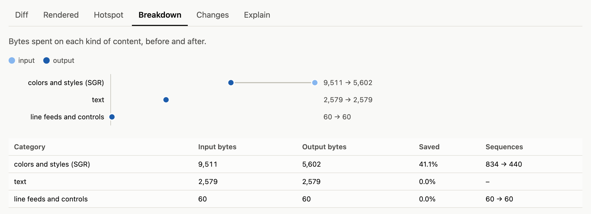
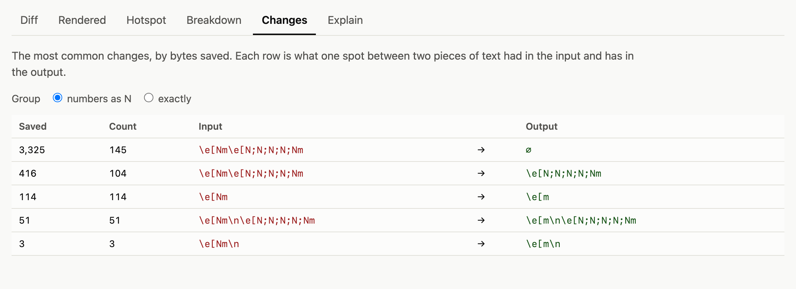

# ansiopt

`ansiopt` rewrites a stream of text and ANSI escape sequences into a shorter
stream that leaves the terminal in the same state. It handles SGR, cursor
movement, modes, OSC (titles, hyperlinks, anything else), DCS/APC/PM/SOS
strings, character sets and plain ESC sequences. Anything it doesn't model
passes through byte for byte.

```nu
"\e[0m\e[1m\e[31mhi\e[0m\e[0m\n" | ansiopt --show
# => \e[;1;31mhi\e[m\n
"\e[0m\e[1m\e[31mhi\e[0m\e[0m\n" | ansiopt -s | ignore
# => ansiopt: 24 -> 14 bytes (10 saved, 41.7%)
```

Two resets in a row are one reset, and three SGR sequences before `hi` are
one. On real captures that kind of repetition adds up: bat's output shrinks
by a third.

## Install

```nu
cargo install ansiopt
```

Or from a checkout, `cargo install --path .`. Adding
`--no-default-features` builds without the `vt100` dependency, at the cost of
the HTML report's rendered preview.

You need Rust 1.88 or newer and nothing else, whether you install the binary
or use the library. Only one test suite in this repository uses Zig, and it
isn't part of the published crate. See [Testing](#testing).

## Usage

```
ansiopt [OPTIONS] [FILE]          # reads stdin when FILE is missing

  -o, --output <FILE>   write to FILE instead of stdout
  -r, --assume-reset    the terminal starts in its default state
      --visual          keep only what is visible (see below)
      --rep             use REP (CSI n b) for runs of one character
  -a, --aggressive      --visual --rep
  -c, --compat          no empty parameters, keep ST terminators
      --max-params <N>  parameters per written sequence (default 16)
      --stream          write output as input arrives
  -s, --stats           print sizes to stderr
      --show            print the result with escapes made visible

views (printed instead of the result unless -o is given):
      --diff            what changed between each piece of text
      --explain         what happened to every input sequence, and why
      --hotspot         the text shaded by escape bytes spent on it
      --all             in --diff and --explain, show everything
      --html <FILE>     an HTML report combining all of them
      --color <WHEN>    auto, always or never (auto respects NO_COLOR)
      --width <N>       columns for the HTML preview
      --height <N>      rows for the HTML preview
```

With `-o`, a view prints to stdout and the minified stream goes to the file,
so `ansiopt --diff -o small.ansi big.ansi` does both at once.

## Results

Bytes saved on captured output from real tools:

| sample            |   bytes | default | `-r -a` |
|-------------------|--------:|--------:|--------:|
| `bat`             | 340,095 |   35.9% |   53.2% |
| `delta`           |  35,027 |    6.8% |   35.6% |
| `git log -p`      | 126,235 |    9.3% |   23.8% |
| `lsd -la`         |  63,006 |   24.9% |   35.4% |
| `nu` table        |  12,038 |   28.9% |   41.8% |
| `nvim` screen     |   5,217 |    4.4% |   39.6% |
| `eza -la`         |  30,867 |    7.9% |   18.8% |
| `rg`              |  13,776 |   12.7% |   12.7% |
| `cargo check`     |  28,159 |    6.2% |    6.2% |
| `git log --graph` |  25,563 |    0.9% |    0.9% |

Output that already writes one SGR per color change (git's graph, cargo) has
little to remove. Syntax highlighters and TUIs repeat themselves a lot.

## Seeing what changed

Four views show what the optimizer did and why. They all line the input up
with the output on their text: the optimizer never changes or reorders
printed characters, only the escape sequences between them, so each spot
between two characters can be compared on its own. A byte-level diff would
mostly show noise from sequences that were merged or moved.

The screenshots below use the captures in `tests/fixtures`, so you can run
the same commands.

### `--diff`: what changed at each spot



How to read it:

- The first line gives the size before and after, and how many of the spots
  between two pieces of text changed.
- Changes that only spell the same thing shorter, like `\e[0m` becoming
  `\e[m`, are counted on the second line but not listed. `--all` lists them
  too.
- `@@ in 24 · out 20 @@` is where the spot is: byte 24 of the input, byte 20
  of the output. After it comes the text on either side, with `▸` marking
  the spot.
- The red `-` line is what the input had there, and the green `+` line is
  what ansiopt writes instead. `(nothing)` means it was all dropped. The
  gray column decodes each sequence: `;` separates sequences, `·` separates
  the attributes inside one SGR.
- The table at the end groups the changes, with numbers shown as `N`, and
  sorts them by bytes saved. Here the top row says that twelve times, a
  reset plus bold plus red became a single bold-red sequence. The reset was
  pointless because the colors had already been reset at that point.

### `--explain`: what happened to every sequence



Each row is one sequence from the input: its byte offset, the sequence, what
it means, and what ansiopt did with it. The second line counts every
outcome. Sequences written unchanged are counted but only listed with
`--all`. The outcomes:

| what happened | meaning |
|---|---|
| folded into `X` | A color, hyperlink or character set change, written later as part of `X` once text needed it. Several input sequences often fold into one. |
| merged into `X` | Combined with neighboring cursor movements or mode changes into `X`. |
| rewritten as `X` | The same sequence, spelled shorter. |
| no effect | Changed nothing by the time it mattered, like setting the color that was already in use. |
| dropped | Made pointless by something later: a movement followed by an absolute move, a mode changed again before it mattered, a full reset. |
| barrier | Copied as is. ansiopt writes all pending state out first and stops assuming what the sequence might change. |
| kept | Written unchanged. |

`at N` is the byte offset in the output.

### `--hotspot`: where the bytes go



Each run of text is shaded by how many escape bytes the input spent right
before it, which is usually what it cost to color that run. The key at the
top gives the scale. The `in` and `out` columns total each line for the
input and the output, and `⏎` marks bytes spent at the end of a line,
usually a reset before the line feed. Line feeds themselves aren't counted.

In this bat capture almost every token costs 20 to 40 bytes: bat resets and
re-sends a 24-bit color before each one, even when the color doesn't change.

### `--html`: a report to share

`ansiopt --html report.html FILE` writes one self-contained page with all of
the above. The screenshots come from `ansiopt --html report.html
tests/fixtures/bat.ansi`.

<picture>
  <source media="(prefers-color-scheme: dark)" srcset="docs/images/report-diff-dark.png">
  
</picture>

The tiles at the top summarize the run: bytes in and out, the share saved,
how many escape sequences there were before and after, and how many spots
between two pieces of text changed.

The **Diff** tab shows the text as the input draws it, in its own colors.
At each spot that changed, red struck-through chips are what the input had
and green chips are what ansiopt writes instead; `∅` means nothing is
written there. Hover over a chip to see what it does and what happened to
it. Two checkboxes bring back what's hidden by default: changes that only
spell the same thing shorter, and sequences that didn't change at all.

<picture>
  <source media="(prefers-color-scheme: dark)" srcset="docs/images/report-rendered-dark.png">
  
</picture>

The **Rendered** tab draws the input and the output on the same screen size
with the `vt100` crate and compares every cell and the cursor. "✓
Identical" means the two produce the same screen; otherwise the differing
cells are outlined. The preview guesses the screen size: as wide as the
longest line and as tall as the output, or, for a full-screen program, the
size it drew on, showing its last frame before it left the alternate
screen. `--width` and `--height` override the guess. Line feeds are treated
as CR LF, the way a terminal's tty delivers program output. This is a check
that both streams draw the same thing, not a screenshot: vt100 has no DEC
line-drawing characters, strikethrough, blink or hyperlinks.

<picture>
  <source media="(prefers-color-scheme: dark)" srcset="docs/images/report-breakdown-dark.png">
  
</picture>

The **Breakdown** tab shows the bytes spent on each kind of content. Each
row has two dots, input and output (the legend tells them apart), and the
line between them is what was saved. Text never changes, so its two dots
sit on top of each other. The table underneath has the exact numbers.

<picture>
  <source media="(prefers-color-scheme: dark)" srcset="docs/images/report-changes-dark.png">
  
</picture>

The **Changes** tab is the table from the end of `--diff`. It can group with
numbers shown as `N` or by exact bytes. Here the first row is bat's biggest
waste: 145 times it sent a reset and a 24-bit color that changed nothing,
and ansiopt wrote nothing in their place.

The **Hotspot** and **Explain** tabs match the terminal views. Hotspot can
also shade by output bytes or bytes saved, and Explain can filter by
outcome.

Everything from the stream is HTML-escaped and no link in it is made
clickable, so a report built from an untrusted capture is safe to open.

To regenerate these screenshots after changing a view, run
`nu docs/screenshots.nu` (it needs Google Chrome).

## As a library

```nu
cargo add ansiopt
```

A dependency gets only the library; the `ansiopt` binary is built by
`cargo install`.

```rust
let out = ansiopt::minify(b"\x1b[0m\x1b[1m\x1b[31mhi\x1b[0m\x1b[0m", &Default::default());
assert_eq!(out, b"\x1b[;1;31mhi\x1b[m");
```

`minify_detailed` also reports whether ansiopt fell back to the input and,
when asked, records a trace of what happened to each token. The
`ansiopt::report` module builds the views from that.

`Minifier` is the streaming form. Call `feed` for each chunk, `flush` when
the producer may pause, and `finish` at the end. Two things only `minify`
does. It falls back to the input if the output would be longer. And visual
mode's self-disable (see below) covers the whole input instead of starting
at the chunk that triggered it.

The HTML report's rendered preview uses the `vt100` crate through the
default `render` feature. Library users who only need minification can turn
it off with `default-features = false`.

## How it works

### Tokens with their bytes

A small lexer follows the DEC/ECMA-48 state machine that xterm, VTE, kitty
and alacritty implement. Unlike `vte` it keeps the raw bytes of every token,
so malformed or unknown sequences can be copied out unchanged. I didn't use
`vte` for this reason. Its callbacks don't expose the original bytes, and
re-encoding what it parsed would change things the optimizer doesn't
understand. Input is treated as UTF-8. Stray C1 bytes and C1 code points
become barriers.

### Lazy state with unknowns

The optimizer tracks the pen (SGR attributes), the OSC 8 hyperlink and the
G0-G3 character sets twice. `desired` is what the input has asked for so far.
`emitted` is what the output has told the terminal. SGR, OSC 8 and charset
sequences only update `desired`. Nothing is written until something makes
those attributes visible:

- printed text needs everything;
- erase, insert/delete, scrolling and line feed need what erased cells take on;
- DECSC, unknown sequences and the end of the stream need everything.

At that point it writes the shortest SGR that turns `emitted` into `desired`.
It compares setting the changed attributes one by one (`22;2`) against a reset
followed by every non-default attribute (`;2`, with an empty parameter for the
reset), and splits long sequences.

Every attribute is tri-state, with unknown as the third value. The stream
starts unknown unless you pass `-r`, so `ESC[1m` printed into a terminal that
was already red stays red. A reset is only used when nothing is unknown,
because a reset would destroy attributes the input never touched.
Save/restore, DECSTR and similar operations keep only the values they are
certain about.

### Other rewrites

- Cursor movement: CUP makes earlier movements dead, same-direction moves add
  up, absolute moves absorb relative ones, and default parameters are dropped
  (`ESC[1;1H` becomes `ESC[H`, `ESC[1;5H` becomes `ESC[;5H`).
- Mode changes for independent flags (`?25`, `?2004`, `?1`, ...) are batched
  into one sequence and dropped when the terminal already has that value.
- Window titles that equal the current title are dropped.
- OSC strings end in BEL instead of `ESC \`, except queries, because the
  terminal answers with the terminator the query used.
- Redundant charset designations go away (`tput sgr0` writes `ESC(B` every
  time).
- `--rep` turns runs like `────────` into one character plus `ESC[7b`.

### Visual mode

`--visual` keeps what you can see instead of the exact cell contents. A space
or an erased cell shows background, underline, strikethrough and so on, but
not foreground, bold or italic. So those aren't refreshed for blank cells.
With `-r`, `ESC[31mfoo ESC[0m ESC[31mbarESC[0m` becomes `ESC[31mfoo  barESC[m`.
Without `-r` the reset stays, because it also sets a background that was
unknown before.
Reverse video turns this off, since it swaps foreground into the background.
A combining mark printed onto an earlier blank cell would expose the
difference. After cursor movement, or at the right margin with autowrap off,
that cell isn't even the one just printed. So visual mode switches itself off
when any character that might combine appears. Output printed *after* the
stream is out of its reach: a combining mark drawn onto one of those blanks
later shows the stale foreground. That's the trade-off of this mode.

## What is never assumed

Terminals disagree more than you'd expect. Every rule below came from a
mismatch the fuzzer found against vt100, alacritty (an earlier oracle) or
Ghostty:

- Colon sub-parameters (`4:3`, `38:2::r:g:b`) are barriers. Some terminals
  ignore them, others read `:` as `;` and turn `4:3` into underline plus
  italic.
- An SGR ending in an empty parameter (`ESC[31;m`) is a barrier. xterm reads
  it as a reset, Ghostty ignores it. Leading and middle empty parameters read
  as `0` in every terminal tested, which is why `ESC[;31m` is a safe reset.
- `21`, `6`, `20`, `58`/`59` and `60`-`65` are barriers. `21` means double
  underline or "bold off" depending on the terminal, and without underline
  color support `58;5;0` reads as "blink, reset". Dropping an earlier `4`
  because a later `21` replaces it would be wrong on a terminal that ignores
  `21`.
- Bold and faint replace each other in some terminals and combine in others,
  so when both are on the optimizer keeps their order.
- `38;5;1` and `31` are kept distinct. Bold-as-bright treats them
  differently.
- Tabs aren't plain movements. Alacritty records them in the cells they skip
  and wraps a pending line.
- With origin mode on, alacritty applies the top margin twice for CHA,
  Ghostty does the same for HPR, and vt100 ignores origin mode for VPA. CR,
  CHA, HPR and VPA rewrites therefore need origin mode known off.
- Some terminals only clamp relative movement at a margin when the cursor
  started inside the margins. Moves only add up when there are no margins.
- `0` is only dropped where every terminal reads it as the default. Ghostty
  treats `ESC[0L` and `ESC[0M` as no-ops, xterm as one line, so only `1` is
  dropped for IL, DL, ICH, DCH, ECH, SU, SD and REP.
- A hyperlink opened without `id=` gets a new identity from every OSC 8, so
  re-opening the same URL isn't redundant.
- Only `OSC 8;;` closes a hyperlink. Ghostty ignores an empty URI that comes
  with parameters (`OSC 8;id=1;`).
- OSCs can have side effects. Ghostty starts a fresh line on `OSC 133;A`, so
  any OSC not known to be quiet (titles, colors, cwd, clipboard,
  notifications) gets the full pen synced first.
- Ghostty keeps cursor state, hyperlink included, per screen, so every screen
  switch (`?47`, `?1047`, `?1048`, `?1049`) makes the pen unknown.
- An OSC cut short by another escape sequence must still be followed by
  `ESC`. The token after it is copied verbatim.

Most of the geometry rules start unknown and switch on once the stream sets
the mode, or right away with `-r`.

## Testing

The differential suite renders `prefix + input + suffix` and
`prefix + output + suffix` in independent emulators and compares every cell,
the cursor, the pen, modes and the title. Random prefixes put the terminal in
an arbitrary state first. Random suffixes check the state the stream leaves
behind. Failures shrink to a minimal case automatically. The harness is
`tests/harness/mod.rs` and runs against two oracles:

- the `vt100` crate, in `tests/oracle.rs`, so plain `cargo test` needs nothing
  but Rust;
- Ghostty's terminal core through [libghostty-vt], next to vt100, in the
  `ghostty-oracle` workspace crate.

The two disagree with each other on bold and faint, VPA in origin mode, what
erased cells keep, trailing empty parameters and more. That disagreement is
what makes the pair useful.

```nu
cargo test --release                                      # vt100, 20k cases per suite
cargo test --release -p ghostty-oracle                    # vt100 + Ghostty, needs Zig
ANSIOPT_FUZZ_ITERATIONS=200000 ANSIOPT_FUZZ_SEED=3 cargo test --release -p ghostty-oracle
ANSIOPT_CORPUS=dir cargo test --release -p ghostty-oracle corpus
```

The `corpus` test runs the captures in `tests/fixtures` (bat, rg, a nu
table with hyperlinks, vim, nvim) through both oracles, or the directory in
`ANSIOPT_CORPUS` instead. The fixtures were made from this repository's own
files; the nu table's `file://` links point at `/home/user/ansiopt` rather
than the machine they were captured on.

`tests/report.rs` checks the views. On random streams, the alignment's
pieces must rebuild both input and output exactly, tracing must not change
the output, and every token must end up with exactly one fate. Every fixture
goes through every view, and the HTML preview must report the two screens
identical.

`ghostty-oracle` builds Ghostty from source with Zig 0.16, which has to be on
`PATH`. It's the only part of the repository that uses Zig, and it isn't
published. You don't need Zig to depend on ansiopt, to install it, or to run
plain `cargo test`. Commands that build every workspace member's tests do
need it, like `cargo test --workspace` and
`cargo check --workspace --all-targets`. `ghostty-oracle` depends on
libghostty-rs `main` at a pinned revision because the crates.io release still
needs Zig 0.15.2. On macOS 27 (Xcode 27's `ld`), Ghostty's build currently
fails while linking its shared library, with a duplicate `_memset` between
Ghostty's fast `memset` and Zig's compiler-rt. Only the static library is
needed. As a local workaround until it's fixed upstream, point
`GHOSTTY_SOURCE_DIR` at a checkout of the pinned Ghostty commit with the
shared-library install disabled. The real fix belongs in Ghostty:
`quirks_memset.zig` exports a strong `memset` for shared libraries, and
`initLibApple` links the dylib from the static archive with `-all_load`,
which also pulls in compiler-rt's copy.

```nu
git clone https://github.com/ghostty-org/ghostty ~/src/ghostty-vt
git -C ~/src/ghostty-vt checkout 3425025e585a3403340d4dc6d65132f42e05e605
# in build.zig, change `shared.install(b.getInstallStep());` to
#   if (!config.target.result.os.tag.isDarwin()) shared.install(b.getInstallStep());
with-env {GHOSTTY_SOURCE_DIR: ('~/src/ghostty-vt' | path expand)} {
    cargo test --release -p ghostty-oracle
}
```

The fuzzer can't see kitty extensions, sixel, or attributes neither emulator
implements (fonts, superscript, framed, proportional spacing). The optimizer
still treats those consistently. Each one is either fully modeled or passed
through as a barrier.

## License

MIT. See [LICENSE](LICENSE).

[libghostty-vt]: https://github.com/uzaaft/libghostty-rs
